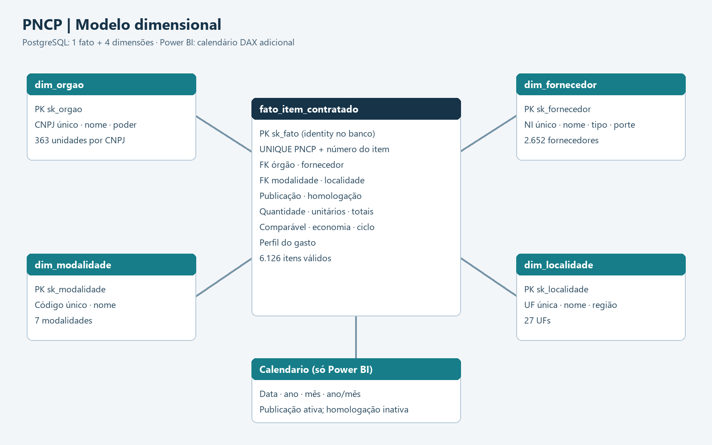
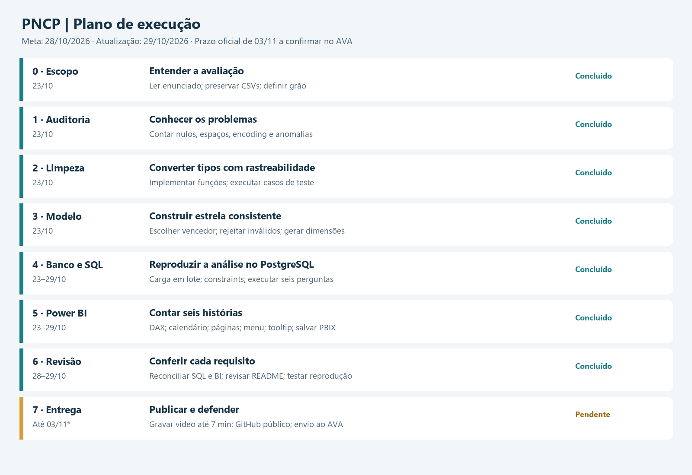

# PNCP · Controladoria de contratações públicas

Projeto final do Módulo 2 do SCTEC — análise de dados com Python, PostgreSQL e Power BI.

O projeto transforma a amostra fornecida de contratações federais publicadas em 2025 em uma base analítica para investigar economia, concentração de fornecedores, modalidades, ciclos, território e perfil do gasto. A amostra não representa todas as compras públicas do país. Volume homologado não equivale a pagamento realizado.

## Resultados reproduzidos em Python

| Controle | Resultado |
|---|---:|
| Compras / itens / resultados brutos | 2.042 / 7.077 / 15.896 |
| Itens com resultado válido antes dos filtros | 6.225 |
| Itens sem resultado / rejeitados | 852 / 99 |
| Itens finais / contratações | 6.126 / 1.962 |
| Itens comparáveis | 5.457 |
| Volume homologado | R$ 8.044.498.805,74 |
| Estimado comparável | R$ 6.867.663.469,91 |
| Economia nos comparáveis | R$ 992.861.686,95 |
| Economia percentual ponderada | 14,46% |
| Ciclos válidos / ausentes | 5.896 / 230 |
| Itens com sobrepreço comparável | 27 |

Evidências: [auditoria](reports/auditoria_pipeline.json), [prova real](reports/prova_real.json) e [dicionário de inconsistências](docs/INCONSISTENCIAS.md). O percentual é a razão entre somas; não é a média dos percentuais dos itens.

Em `compras.csv`, não há repetição de `numero_controle_pncp` (2.042 chaves distintas). Os formatos, nulos disfarçados e acentos quebrados são detalhados no dicionário; as contagens completas por coluna estão em `reports/auditoria_colunas.csv`.

## Arquitetura e decisões

`CSV bruto → auditoria e limpeza Python → tabelas estrela → PostgreSQL → Power BI`



O grão é um item por contratação: `(numero_controle_pncp, numero_item)`. Resultados cancelados saem antes da seleção pela menor ordem de classificação e, no empate, pelo menor sequencial numérico. A quantidade homologada positiva prevalece; na sua ausência, utiliza-se a quantidade do item. A mesma quantidade calcula os dois totais, arredondados a centavos.

São comparáveis os itens fora da modalidade 12 com razão homologado/estimado entre 0,1 e 10, inclusive. Economia pode ser negativa. Para os não comparáveis, `economia_valor` fica NULL: essa escolha atende à seção 4.3 do enunciado, apesar do zero sugerido no roteiro-base. Credenciamento continua no volume total.

Homologação anterior à publicação vira NULL sem excluir o item. Ciclo zero no mesmo dia é válido. Órgãos são dimensionados por CNPJ; a pergunta 4 agrupa pelo nome e exige cinco ciclos válidos. Obras têm prioridade na classificação por palavras inteiras; depois vêm serviços e bens. Todas as 27 UFs são mapeadas para região.

Chaves naturais são únicas nas dimensões. O membro -1 é reservado a ausências de referência. A carga valida as chaves antes de escrever e usa uma única transação para criar e preencher as cinco tabelas; falhas revertem a carga. A criação do banco é uma operação administrativa separada. Recriar um banco existente exige `--recriar` explícito.

## Reprodução

Pré-requisitos: Python 3.10 ou superior, PostgreSQL em execução e Power BI Desktop. Execute os comandos a partir desta pasta:

```powershell
python -m venv .venv
.\.venv\Scripts\python.exe -m pip install -r requirements.txt
Copy-Item .env.example .env
notepad .env
.\.venv\Scripts\python.exe -m src.pipeline
.\.venv\Scripts\python.exe -m pytest -q
.\.venv\Scripts\python.exe -m src.carregar
```

Preencha `.env` com suas credenciais locais; esse arquivo é ignorado pelo Git. Preserve um `.env` já configurado em vez de copiá-lo novamente. O banco padrão é `pncp_controladoria`. Se ele já existir, a carga para e informa o motivo; use `python -m src.carregar --recriar` somente se desejar apagar e reconstruir esse banco.

No pgAdmin, conecte ao banco do projeto e execute [sql/02_perguntas.sql](sql/02_perguntas.sql). As consultas também estão separadas por pergunta. Os CSVs tratados são gerados em `data/processed/`.

Abra [powerbi/PNCP.pbip](powerbi/PNCP.pbip) no Desktop. O modelo aponta para `localhost:5432` e `pncp_controladoria`; ajuste o servidor caso sua instalação use outra porta. Atualize as tabelas, forneça a credencial do banco na janela do aplicativo e confira os totais. O [PNCP.pbix](powerbi/PNCP.pbix) foi salvo com os dados importados e permite revisar o painel sem executar a carga novamente. Para atualizar a fonte em outro computador, informe as credenciais locais no Power BI.

## Power BI e perguntas

| Página | Foco |
|---|---|
| P1 | Economia absoluta e percentual, volume e cobertura comparável |
| P2 | Top 10 fornecedores por identidade e concentração |
| P3 | Volume, economia e deságio por modalidade |
| P4 | Ciclo por nome de órgão com pelo menos cinco ciclos válidos |
| P5 | Volume e economia por UF e região |
| P6 | Composição entre obras, serviços e bens e ticket médio |

As medidas explícitas estão em `Medidas`, organizadas em pastas, e em [medidas.dax](powerbi/medidas.dax). O calendário DAX deriva os limites das datas da fato. Mês e ano/mês têm colunas de ordenação. Publicação é a relação ativa; homologação é inativa e utilizada por `USERELATIONSHIP`. O calendário automático está desativado no modelo. O calendário está marcado como tabela de datas; sua expressão está em [calendario.dax](powerbi/calendario.dax). `Ranking Fornecedor` demonstra o iterador `RANKX`; economia e concentração usam `VAR`, `CALCULATE` e `DIVIDE`.

No Desktop, use **Ctrl + clique** nos botões de menu e navegação (ou selecione o botão e pressione Ctrl + Enter). Passe o mouse sobre gráficos/tabelas para abrir o tooltip personalizado. As conclusões textuais descrevem a amostra completa; os indicadores respondem aos filtros.

## Planejamento



Meta inicial: 28/10/2026; validação técnica concluída em 29/10/2026. O documento menciona 03/11/2016; confirmar a data oficial no AVA. O quadro distingue etapas implementadas de validações e entregas ainda pendentes.

## Validação e entrega

- 61 testes Python aprovados na conferência final de 29/10/2026; inclui os 54 casos fornecidos e a prova real integral.
- Validação nativa PostgreSQL: carga confirmada, grão único e totais reconciliados; seis perguntas executadas. Evidência: [resultados SQL](reports/resultados_postgresql.json).
- Power BI: 25 medidas, seis páginas e PBIX com dados. Conferidos totais, filtro de janeiro, calendário marcado, abertura/fechamento do menu, navegação e tooltip contextual. [Evidências](reports/validacao_powerbi.json).
- Publicação no GitHub e gravação do vídeo: pendentes.

O [roteiro de defesa](docs/ROTEIRO_VIDEO.md) organiza uma apresentação de até sete minutos. **Vídeo: gravação e link público pendentes.** Atualizar este campo antes da entrega. Não enviar ao AVA enquanto os itens obrigatórios do [checklist](docs/CHECKLIST.md) estiverem pendentes.

## Melhorias futuras

Carga incremental com controle de alterações, testes de regressão por recorte, classificação de itens com revisão humana, validação cadastral de documentos, monitoramento da qualidade por lote e atualização agendada do painel. A economia estimada deve ser interpretada com cautela: não comprova eficiência causal nem execução financeira.

## Revisão do painel

O PBIX foi reaberto no Power BI Desktop, preservando os dados e os indicadores. Evidências: [menu](docs/img/menu_powerbi.png), [tooltip contextual](docs/img/tooltip_powerbi.png) e [calendário marcado](docs/img/calendario_marcado.png).

Para validar em conjunto, comece pela página Economia, teste um mês, percorra as seis páginas e compare com [RESULTADOS_SQL.md](docs/RESULTADOS_SQL.md). O [checklist](docs/CHECKLIST.md) separa a implementação concluída das pendências de publicação e entrega.
